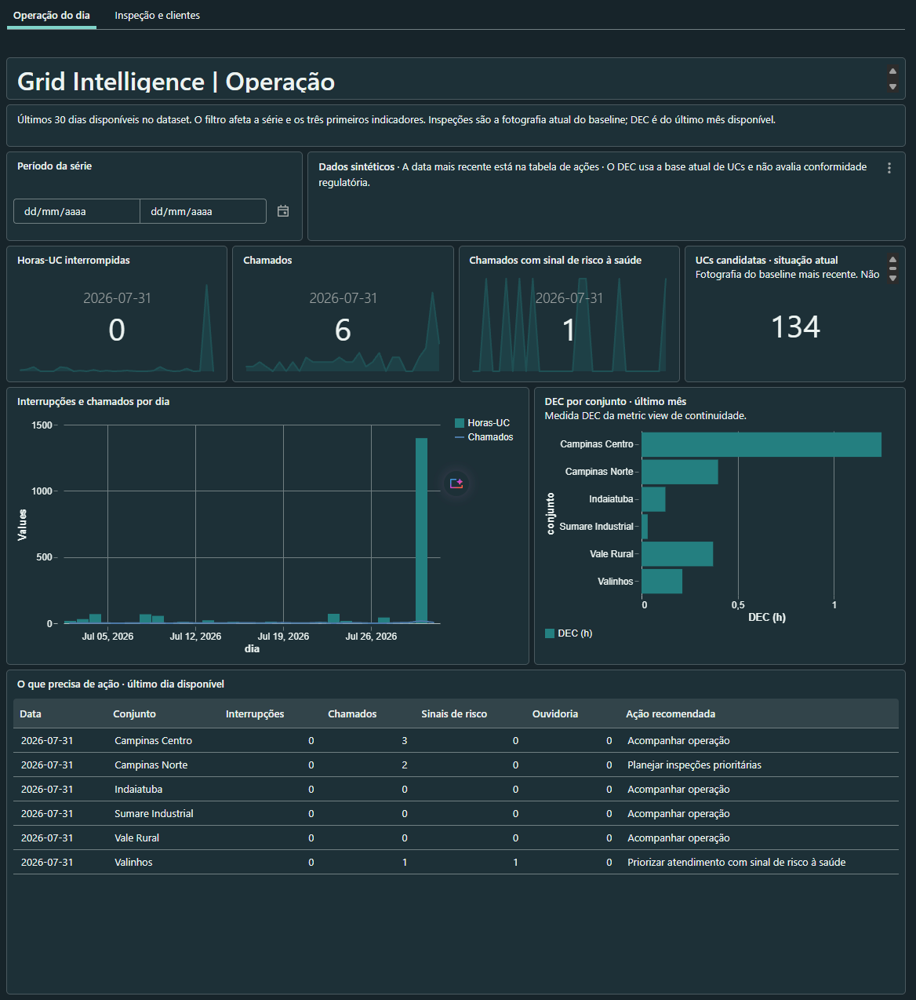
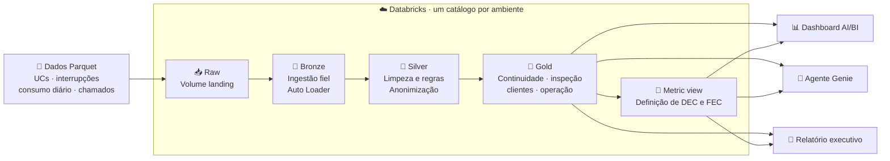
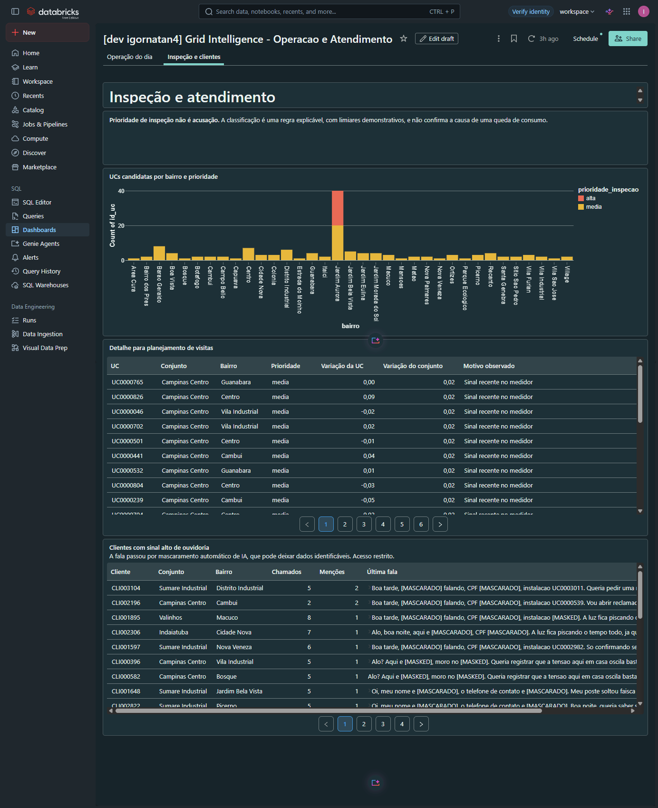
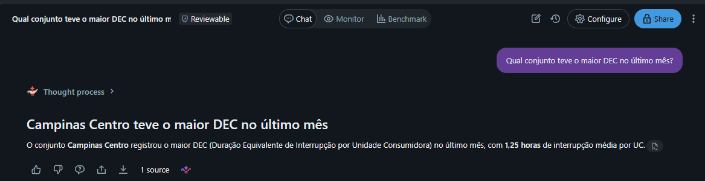

# Grid Intelligence — Luz do Vale Distribuidora

[](https://github.com/IgorNatann/project_vale_energy/actions/workflows/validacao.yml)


Plataforma de dados e IA, no Databricks, para uma distribuidora de energia elétrica
fictícia. O projeto transforma regras regulatórias da ANEEL em dados governados,
indicadores únicos de continuidade, priorização de inspeções e um copiloto que responde em
português sobre a operação.



## Em números

| | |
|---|---|
| **5,85 milhões** de leituras de consumo | 4 anos de histórico de 4.000 unidades consumidoras |
| **310 de 1.383** interrupções fora da apuração | 22,4% abaixo de 3 minutos, descartadas pela regra regulatória |
| **6 de 6** conjuntos com DEC conferido | Metric view igual à auditoria manual dos insumos |
| **20** UCs com prioridade alta de inspeção | Queda individual com a vizinhança estável |
| **84** clientes com sinal alto de ouvidoria | Identificados nas transcrições anonimizadas |

Os dados são sintéticos e os números vêm de uma execução no ambiente de desenvolvimento;
veja [resultados da demonstração](docs/resultados-demonstracao.md).

## O problema

Uma distribuidora regulada pela ANEEL tem três dores, todas mensuráveis em dinheiro:

1. **Continuidade do fornecimento.** Interrupções além do limite regulatório geram
   compensação automática ao consumidor: mais de R$ 1,1 bilhão pagos pelas distribuidoras
   brasileiras em 2024
   ([ANEEL, via Cenário Energia](https://cenarioenergia.com.br/2026/04/15/qualidade-do-fornecimento-melhora-no-brasil-mas-compensacoes-ainda-superam-r-1-bilhao-aponta-aneel/)).
2. **Perdas não técnicas.** Energia distribuída e não faturada somou ~R$ 11,5 bilhões em
   2025
   ([ANEEL, via Poder360](https://www.poder360.com.br/poder-energia/furtos-e-falhas-tecnicas-na-rede-eletrica-custam-r-232-bilhoes-em-2025/)).
3. **Atendimento ao cliente.** As transcrições das ligações trazem o aviso antecipado de
   reclamações na ouvidoria, mas ninguém as lê.

## O que este projeto demonstra

| Pergunta de negócio | Decisão aplicada | Como verificar |
|---|---|---|
| Como acompanhar a continuidade do fornecimento? | Excluir eventos inferiores a três minutos e centralizar DEC e FEC em uma metric view. | [Métricas e exemplos](docs/metricas-e-ia.md) e [regras e evidências](docs/regras-de-negocio.md). |
| Onde priorizar visitas técnicas? | Comparar o consumo da UC com seu histórico e o conjunto, combinando os sinais com o medidor. | [Regras e evidências](docs/regras-de-negocio.md). A prioridade não comprova irregularidade. |
| Como analisar chamados protegendo dados pessoais? | Restringir o acesso ao original e anonimizar antes do enriquecimento por IA ou regras. | [Validação de privacidade](docs/validacao-privacidade.md) e [regras das duas rotas](docs/regras-de-negocio.md). |
| Como apoiar a leitura operacional? | Publicar a Gold em dashboard, Genie e relatório executivo. | [Resultados da demonstração](docs/resultados-demonstracao.md), [avaliação do Genie](docs/avaliacao-genie.md) e [roteiro de apresentação](docs/roteiro-apresentacao.md). |

## Stack

| Área | Tecnologias |
|---|---|
| Governança | Unity Catalog: catálogos por ambiente, volume gerenciado, máscaras de coluna |
| Engenharia de dados | Lakeflow Declarative Pipelines, streaming tables, materialized views, `read_files` |
| Métricas | Metric views do Unity Catalog |
| IA | AI Functions: `ai_mask`, `ai_classify`, `ai_extract`, `ai_analyze_sentiment`, `ai_gen` |
| Consumo | Dashboard AI/BI, Genie e notebook de relatório executivo |
| Entrega | Declarative Automation Bundles, GitHub Actions, uv, pytest e Ruff |

## Arquitetura



Um schema por camada (`raw`, `bronze`, `silver` e `gold`), com os dados chegando no volume
`raw.landing`. Os ambientes ficam isolados **por catálogo** (`grid_dev` e
`grid_intelligence`), e os schemas têm o mesmo nome nos dois: o mesmo SQL roda em qualquer
ambiente. A rota alternativa de tratamento de texto por regras publica em `silver_regras`
para comparação.

## Decisões técnicas

- **A ingestão não corrige nada.** A bronze preserva leituras inválidas de medidor, porque
  elas são um fato sobre o medidor. A limpeza e a regra dos 3 minutos ficam na silver.
- **Uma única definição de DEC e FEC.** Dashboard, agente e relatório consultam a mesma
  metric view. Uma auditoria manual dos insumos confere o resultado.
- **Inspeção por dois eixos, nunca por acusação.** Uma UC só é candidata quando cai contra o
  próprio histórico **e** a vizinhança fica estável; queda do bairro inteiro é evento de
  rede. A saída é uma prioridade explicável (alta, média, baixa), não um modelo treinado nem
  um rótulo de irregularidade.
- **Privacidade em duas camadas.** O texto original fica na bronze com máscara de coluna
  por grupo, e a análise de conteúdo só acontece sobre o texto anonimizado.
- **IA com alternativa determinística.** O enriquecimento das transcrições tem uma rota com
  AI Functions e outra por regras, com as mesmas colunas. O relatório executivo só aceita o
  texto da IA quando ele reproduz os números do gabarito.

O vínculo entre cada regra, sua implementação e as evidências está em
[regras de negócio](docs/regras-de-negocio.md).

## Minhas decisões e extensões

O projeto partiu de uma sequência de prompts de aula ([`prompts/`](prompts/README.md)), que
define o domínio, as regras e as entregas. Os pontos abaixo foram decisões minhas, além do
roteiro:

| Extensão | Por quê |
|---|---|
| [Testes de regras e integração](tests/) | Entregar uma regra não prova que ela funciona. Os testes executam o SQL das transformações sobre casos pequenos e comparam a bronze com os arquivos de origem. |
| [Integração contínua](docs/integracao-continua.md) | Lint e testes rodam em todo PR, sem credenciais do Databricks no GitHub. |
| [Aplicador do Genie](scripts/aplicar_agente_genie.py) | O espaço Genie não é recurso do bundle. O script o recria a partir da definição versionada, sem catálogo fixo e sem sobrescrever um espaço com outras fontes. |
| Rota `silver_regras` em paralelo | Permite comparar a rota com IA e a rota determinística sobre os mesmos dados, sem que uma sobrescreva a outra. |
| [Validação de privacidade](docs/validacao-privacidade.md) | Mascarar não basta: é preciso verificar quem consegue ler o original, e registrar o que ainda não foi provado. |
| [Avaliação do Genie](docs/avaliacao-genie.md) | Perguntas de benchmark com respostas SQL esperadas, separadas dos exemplos do agente: 6 de 6 corretas em uma execução. |
| [Observabilidade e custos](docs/observabilidade-custos.md) | Sucesso do job não é qualidade, e duração não é custo. A consulta às tabelas de sistema mostra o consumo faturável. |

## Dashboard, agente e relatório

**Dashboard AI/BI**: duas páginas, operação do dia (acima) e inspeção e atendimento:



**Agente Genie**: o [copiloto de operações](src/genie/grid_intelligence.json) responde em
português usando somente as fontes da gold. O campo de transcrição fica fora do contexto do
agente. Os testes de conversação estão em [validação do agente](docs/validacao-agente-genie.md).



**Relatório executivo**: o [notebook](src/notebooks/relatorio_executivo.py) lê somente a
gold e gera um resumo para a diretoria. Veja uma
[execução de exemplo](docs/relatorio-executivo-exemplo.md).

## Como executar

Pré-requisitos: [uv](https://docs.astral.sh/uv/getting-started/installation/), a
[Databricks CLI](https://docs.databricks.com/dev-tools/cli/install) autenticada e os
catálogos `grid_dev` e `grid_intelligence` criados.

```bash
uv sync --dev
databricks bundle deploy -t dev --profile <perfil>
# copie data/ para o volume raw.landing (comandos no guia de operação)
databricks bundle run processar_grid --profile <perfil>
```

O passo a passo completo, com a criação dos catálogos, o upload dos dados, as rotas de IA e
de regras, o Genie e os cuidados de governança, está em [operação](docs/operacao.md).

## Testes e CI

```bash
uv run pytest                                   # testes locais
uv run pytest --databricks --perfil <perfil>    # inclui os testes contra o workspace
```

O workflow de [integração contínua](docs/integracao-continua.md) roda Ruff e pytest em todo
PR, sem credenciais do Databricks. Os testes de integração executam o SQL das
transformações sobre exemplos pequenos e comparam a bronze com os Parquet do volume.

## Documentação

| Documento | Conteúdo |
|---|---|
| [Operação](docs/operacao.md) | Setup, deploy, governança e testes |
| [Regras de negócio](docs/regras-de-negocio.md) | Cada regra, onde está implementada e como verificar |
| [Métricas e IA](docs/metricas-e-ia.md) | Definições de DEC e FEC e interpretação dos sinais de IA |
| [Resultados da demonstração](docs/resultados-demonstracao.md) | As oito consultas de prova e seus resultados |
| [Validação de privacidade](docs/validacao-privacidade.md) | Máscaras, acessos e o que ainda falta validar |
| [Validação do agente](docs/validacao-agente-genie.md) e [avaliação do Genie](docs/avaliacao-genie.md) | Conversas de teste e benchmark reproduzível |
| [Observabilidade e custos](docs/observabilidade-custos.md) | Histórico do job e consumo faturável |
| [Integração contínua](docs/integracao-continua.md) | O que o CI verifica e o que não verifica |
| [Roteiro de apresentação](docs/roteiro-apresentacao.md) | Sequência para demonstrar o projeto |
| [PRD](.llm/prd.md) | Domínio, glossário, regras e modelo de informação |

## Estrutura

| Caminho | Conteúdo |
|---|---|
| `databricks.yml` | Definição do bundle: variáveis e targets `dev` e `prod` |
| `resources/` | Recursos do bundle (schemas, volume, pipelines, job, dashboard) |
| `src/pipelines/` | Transformações bronze, silver e gold |
| `src/sql/` | Governança, metric view e consultas de demonstração |
| `src/notebooks/` | Notebook do relatório executivo |
| `src/dashboards/` e `src/genie/` | Definições versionadas do dashboard e do agente |
| `scripts/` | Aplicador do espaço Genie |
| `tests/` | Testes de regras e integração com Databricks |
| `data/` | As quatro bases sintéticas em Parquet |
| `docs/` | Regras, resultados e validações |
| `prompts/` | A sequência de prompts usada na construção |

## Limitações conhecidas

- Os dados são sintéticos; os números descrevem a amostra, podem mudar entre execuções e
  não são conclusões sobre pessoas reais.
- Sem os limites regulatórios de cada conjunto, os indicadores não permitem concluir se
  houve conformidade. A base de UCs é a do cadastro atual, não uma série histórica.
- Os limiares de inspeção são demonstrativos. A prioridade é um sinal para vistoria, não a
  causa de uma queda de consumo.
- O mascaramento por IA pode deixar dados identificáveis, e a rota por regras não reconhece
  apelidos nem endereços livres. Revise antes de compartilhar o texto anonimizado.
- Falta validar o acesso com uma identidade fora do grupo `atendimento` e as permissões
  da landing.
- Respostas de linguagem natural do Genie e textos gerados por IA variam entre execuções e
  devem ser revisados.

## Desenvolvimento com IA

O projeto foi construído com assistentes de código, a partir da sequência de prompts em
[`prompts/`](prompts/README.md), usando as **Databricks AI Tools** v0.2.41 e suas
[skills oficiais](https://docs.databricks.com/aws/en/agent-skills/) (instaladas com
`databricks aitools install`) para CLI, pipelines, Unity Catalog, dashboard e Genie. As
skills apoiam o assistente; as decisões de negócio, a revisão dos resultados e a validação
por testes foram feitas à parte. Essa ferramenta de desenvolvimento não se confunde com o
agente Genie entregue pelo projeto.

## Licença

Distribuído sob a [licença MIT](LICENSE).
