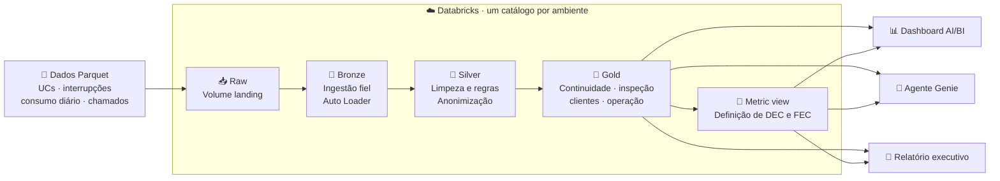

# Grid Intelligence — Luz do Vale Distribuidora

Plataforma de dados e IA de uma distribuidora de energia elétrica fictícia, a **Luz do Vale
Distribuidora S.A.**, construída no Databricks com Declarative Automation Bundles (DABs).

O projeto ataca três dores de uma distribuidora regulada pela ANEEL:

1. **Continuidade do fornecimento**: indicadores DEC e FEC por conjunto.
2. **Perdas não técnicas**: prioridade de inspeção para unidades consumidoras com queda de
   consumo.
3. **Atendimento ao cliente**: transcrições de chamados anonimizadas e enriquecidas.

A construção segue uma sequência de prompts para o Claude Code, descrita em
[`prompts/README.md`](prompts/README.md).

## Estrutura

| Caminho | Conteúdo |
|---|---|
| `databricks.yml` | Definição do bundle: variáveis e targets `dev` e `prod` |
| `resources/` | Recursos do bundle (schemas, volume, pipelines, jobs, dashboard) |
| `src/project_vale_energy/` | Código Python compartilhado por jobs e pipelines |
| `tests/` | Testes de regras e integração com Databricks |
| `fixtures/` | Dados de apoio para testes |
| `data/` | As quatro bases sintéticas em Parquet, para subir no volume |
| `prompts/` | A sequência de prompts que constrói o projeto |

## Os dados

| Base | Grão | Volume |
|---|---|---|
| `unidades_consumidoras` | uma por ponto de entrega | 4.000 |
| `interrupcoes` | uma por evento de rede | 1.383 |
| `consumo_diario` | uma por UC por dia | ~5,85 milhões (4 anos) |
| `chamados` | uma por ligação, com transcrição | 2.801 |

As bases têm **defeitos propositais** (consumo nulo, negativo ou impossível, linhas
duplicadas e interrupções com menos de 3 minutos). Não são bugs: eles existem para as
validações de qualidade terem o que fazer.

## Arquitetura

O diagrama apresenta a **arquitetura planejada**: o setup da infraestrutura vem primeiro;
as camadas de dados e as entregas são construídas nos prompts seguintes.



Um schema por camada (`raw`, `bronze`, `silver` e `gold`), com os dados chegando no volume
`raw.landing`. Os ambientes `dev` e `prod` ficam isolados **por catálogo**, e os nomes dos
schemas são os mesmos nos dois. Assim o mesmo SQL roda em qualquer ambiente.

| Ambiente | Catálogo |
|---|---|
| `dev` | `grid_dev` |
| `prod` | `grid_intelligence` |

O domínio, o glossário, as regras de negócio e o modelo de informação estão em
[`.llm/prd.md`](.llm/prd.md).

## Ambiente local

Pré-requisitos:

- [uv](https://docs.astral.sh/uv/getting-started/installation/)
- [Databricks CLI](https://docs.databricks.com/dev-tools/cli/install)

Instale as dependências:

```bash
uv sync --dev
```

Autentique no workspace, se ainda não fez isso:

```bash
databricks configure --profile project_vale_energy
```

## Setup do workspace

### Catálogos

Catálogo é a única coisa que o bundle não cria. Crie os dois por SQL: em contas com
Default Storage (como a Free Edition), `databricks catalogs create` falha com
`Metastore storage root URL does not exist`.

```bash
databricks experimental aitools tools query --profile project_vale_energy \
  "CREATE CATALOG IF NOT EXISTS grid_dev COMMENT 'Catalogo de desenvolvimento da Grid Intelligence'"

databricks experimental aitools tools query --profile project_vale_energy \
  "CREATE CATALOG IF NOT EXISTS grid_intelligence COMMENT 'Catalogo de producao da Grid Intelligence'"
```

Quem cria o catálogo é dono dele. Para dar acesso a outro usuário:

```bash
databricks grants update CATALOG grid_dev \
  --json '{"changes":[{"principal":"EMAIL","add":["ALL_PRIVILEGES"]}]}' \
  --profile project_vale_energy
```

### Schemas e volume

Os schemas `raw`, `bronze`, `silver` e `gold` e o volume `raw.landing` estão em
[`resources/grid_schemas.yml`](resources/grid_schemas.yml) e são criados pelo deploy.

### Dados

Uma pasta por base no volume. A pasta, e não o arquivo, é o contrato com a camada bronze.

```bash
databricks fs cp -r data/unidades dbfs:/Volumes/grid_dev/raw/landing/unidades_consumidoras --overwrite --profile project_vale_energy
databricks fs cp -r data/interrupcoes dbfs:/Volumes/grid_dev/raw/landing/interrupcoes --overwrite --profile project_vale_energy
databricks fs cp -r data/consumo_diario dbfs:/Volumes/grid_dev/raw/landing/consumo_diario --overwrite --profile project_vale_energy
databricks fs cp -r data/chamados dbfs:/Volumes/grid_dev/raw/landing/chamados --overwrite --profile project_vale_energy
```

### Recomeçar do zero

> ⚠️ **Destrutivo e sem confirmação.** `CASCADE` apaga o catálogo inteiro: schemas,
> tabelas, volumes e os arquivos dentro deles. Não há como desfazer.

```bash
databricks experimental aitools tools query --profile project_vale_energy \
  "DROP CATALOG IF EXISTS grid_dev CASCADE"
```

## Deploy

```bash
databricks bundle validate --profile project_vale_energy
databricks bundle deploy -t dev --profile project_vale_energy
databricks bundle run processar_grid --profile project_vale_energy
```

`dev` é o target padrão. Em `mode: development`, os recursos recebem o prefixo
`[dev seu_usuario]` e os agendamentos ficam pausados. Para produção, use `-t prod`.

O job executa o pipeline e reaplica as máscaras das colunas pessoais na bronze. Execute o
job completo: um full refresh pode recriar a tabela de chamados e remover as máscaras, e
uma execução direta do pipeline não executa a task de governança.

O pipeline usa `usar_ia: "true"` por padrão. Para a rota por regras, ajuste a variável
`usar_ia` do bundle para `"false"` antes do deploy. A máscara de acesso usa o grupo local
`atendimento`; a identidade que executa o pipeline precisa pertencer a ele para processar
as transcrições originais. Por ser local ao workspace, o grupo não recebe privilégios do
Unity Catalog: cada pessoa precisa ter acesso à tabela por outra concessão. As máscaras na
bronze não substituem as permissões de acesso aos arquivos originais no volume `raw.landing`.

## Testes

Os testes executam o SQL das transformações sobre exemplos pequenos e comparam as tabelas
bronze com os Parquet do volume. Requerem a CLI autenticada, um SQL warehouse e as tabelas
da bronze e silver já implantadas e atualizadas:

```bash
uv run pytest --databricks --perfil project_vale_energy --catalogo grid_dev
```

Sem `--databricks`, os testes que dependem do warehouse são ignorados. Para verificar também
que uma nova execução sem arquivos novos não duplica a bronze, acrescente
`--reexecutar-pipeline`. Essa opção executa o job no target `dev` e está restrita ao
catálogo `grid_dev`; não faz full refresh. O comando deve ser executado na raiz do bundle.

Os testes de regras substituem as fontes de streaming por dados de teste em consultas SQL;
eles não simulam o mecanismo de streaming. A reexecução e a comparação com os arquivos
complementam essa verificação no ambiente implantado. Os limites de consumo testados são os
valores demonstrativos aprovados para este projeto.
Os testes que comparam as transcrições com a origem devem ser executados por uma identidade
do grupo `atendimento`; eles consultam apenas contagens de dados identificáveis restantes.

A rota por regras mascara o nome informado no cadastro e padrões de CPF e telefone; ela
não identifica com segurança apelidos, outros nomes ou endereços livres. Seu resultado deve
ser avaliado antes de ser usado como texto anonimizado.
