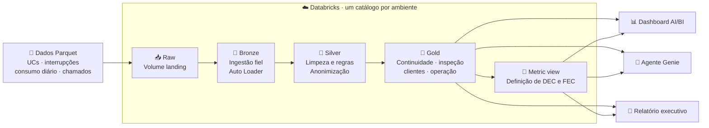

# Grid Intelligence — Luz do Vale Distribuidora

Plataforma de dados e IA de uma distribuidora de energia elétrica fictícia, a **Luz do Vale
Distribuidora S.A.**, construída no Databricks com Declarative Automation Bundles (DABs).
O objetivo é demonstrar, com dados sintéticos, como decisões de negócio se transformam em
dados governados, indicadores e ferramentas de apoio à operação.

O projeto ataca três dores de uma distribuidora regulada pela ANEEL:

1. **Continuidade do fornecimento**: indicadores DEC e FEC por conjunto.
2. **Perdas não técnicas**: prioridade de inspeção para unidades consumidoras com queda de
   consumo.
3. **Atendimento ao cliente**: transcrições de chamados anonimizadas e enriquecidas.

A construção segue uma sequência de prompts para o Claude Code, descrita em
[`prompts/README.md`](prompts/README.md).

## Desenvolvimento com IA

O desenvolvimento contou com assistentes de código e ferramentas do ecossistema
[Databricks AI Dev Kit](https://github.com/databricks-solutions/ai-dev-kit), também
referenciado como AI Dev Kit 2.0. Nesta evolução, foram usadas as **Databricks AI Tools**
e suas skills oficiais para orientar tarefas de CLI, pipelines, Unity Catalog, dashboard
e Genie, além de executar consultas e verificar recursos no workspace. As instruções das
skills apoiam o trabalho do assistente; decisões de negócio, revisão dos resultados e
validação por testes continuam necessárias.

As skills oficiais são instaladas pela CLI com `databricks aitools install`; consulte a
[documentação de agent skills da Databricks](https://docs.databricks.com/aws/en/agent-skills/)
para opções e compatibilidade. A própria documentação recomenda remover skills antigas do
AI Dev Kit antes de instalar as oficiais, evitando conflitos. A ferramenta de desenvolvimento
é distinta do agente Genie entregue como parte do projeto.

## O que este projeto demonstra

| Pergunta de negócio | Decisão aplicada | Como verificar |
|---|---|---|
| Como acompanhar a continuidade do fornecimento? | Excluir eventos inferiores a três minutos e centralizar DEC e FEC em uma metric view. | [Métricas e exemplos](docs/metricas-e-ia.md) e [regras e evidências](docs/regras-de-negocio.md). |
| Onde priorizar visitas técnicas? | Comparar o consumo da UC com seu histórico e o conjunto, combinando os sinais com o medidor. | [Regras e evidências](docs/regras-de-negocio.md). A prioridade não comprova irregularidade. |
| Como analisar chamados protegendo dados pessoais? | Restringir o acesso ao original e anonimizar antes do enriquecimento por IA ou regras. | [Validação de privacidade](docs/validacao-privacidade.md) e [regras das duas rotas](docs/regras-de-negocio.md). |
| Como apoiar a leitura operacional? | Publicar a Gold em dashboard, Genie e relatório executivo. | [Resultados da demonstração](docs/resultados-demonstracao.md), [avaliação do Genie](docs/avaliacao-genie.md) e [roteiro de apresentação](docs/roteiro-apresentacao.md). |

No ambiente de desenvolvimento, foram observadas 20 UCs de prioridade alta e 84 clientes
com sinal alto de risco de ouvidoria em uma execução. Esses números descrevem a amostra
sintética, podem mudar entre execuções e não são conclusões sobre pessoas reais. A regra
RN-03 ainda não foi definida; o teste de acesso por identidade fora do grupo de atendimento
permanece pendente. Resultados gerados por IA devem ser revisados.

## Estrutura

| Caminho | Conteúdo |
|---|---|
| `databricks.yml` | Definição do bundle: variáveis e targets `dev` e `prod` |
| `resources/` | Recursos do bundle (schemas, volume, pipelines, jobs, dashboard) |
| `src/project_vale_energy/` | Código Python compartilhado por jobs e pipelines |
| `src/pipelines/` | Transformações bronze, silver e gold |
| `src/notebooks/` | Notebook do relatório executivo |
| `src/sql/` | Governança, metric view e consultas de demonstração |
| `src/dashboards/` e `src/genie/` | Definições versionadas do dashboard e do agente |
| `scripts/` | Aplicador do espaço Genie |
| `docs/` | Regras, resultados de demonstração e validação do agente |
| `tests/` | Testes de regras e integração com Databricks |
| `fixtures/` | Dados de apoio para testes |
| `data/` | As quatro bases sintéticas em Parquet, para subir no volume |
| `prompts/` | A sequência de prompts que constrói o projeto |

## Os dados

| Base | Grão | Volume |
|---|---|---|
| `unidades_consumidoras` | uma por ponto de entrega | 4.000 |
| `interrupcoes` | uma por evento de rede | 1.383 |
| `consumo_diario` | uma por UC por dia | ~5,85 milhões (4 anos) |
| `chamados` | uma por ligação, com transcrição | 2.801 |

As bases têm **defeitos propositais** (consumo nulo, negativo ou impossível, linhas
duplicadas e interrupções com menos de 3 minutos). Não são bugs: eles existem para as
validações de qualidade terem o que fazer.

## Arquitetura

O diagrama resume as camadas e entregas implementadas no projeto. A rota alternativa de
tratamento de texto por regras publica em `silver_regras` para comparação; a Gold usa a
silver principal.



Um schema por camada (`raw`, `bronze`, `silver` e `gold`), com os dados chegando no volume
`raw.landing`. Os ambientes `dev` e `prod` ficam isolados **por catálogo**, e os nomes dos
schemas são os mesmos nos dois. Assim o mesmo SQL roda em qualquer ambiente.

| Ambiente | Catálogo |
|---|---|
| `dev` | `grid_dev` |
| `prod` | `grid_intelligence` |

O domínio, o glossário, as regras de negócio e o modelo de informação estão em
[`.llm/prd.md`](.llm/prd.md).
O vínculo entre cada regra, sua implementação e as evidências está em
[`docs/regras-de-negocio.md`](docs/regras-de-negocio.md).

## Ambiente local

Pré-requisitos:

- [uv](https://docs.astral.sh/uv/getting-started/installation/)
- [Databricks CLI](https://docs.databricks.com/dev-tools/cli/install)

Instale as dependências:

```bash
uv sync --dev
```

Autentique no workspace, se ainda não fez isso:

```bash
databricks configure --profile project_vale_energy
```

## Setup do workspace

### Catálogos

Catálogo é a única coisa que o bundle não cria. Crie os dois por SQL: em contas com
Default Storage (como a Free Edition), `databricks catalogs create` falha com
`Metastore storage root URL does not exist`.

```bash
databricks experimental aitools tools query --profile project_vale_energy \
  "CREATE CATALOG IF NOT EXISTS grid_dev COMMENT 'Catalogo de desenvolvimento da Grid Intelligence'"

databricks experimental aitools tools query --profile project_vale_energy \
  "CREATE CATALOG IF NOT EXISTS grid_intelligence COMMENT 'Catalogo de producao da Grid Intelligence'"
```

Quem cria o catálogo é dono dele. Para outras identidades, conceda somente os privilégios
necessários após revisar também o acesso ao volume e às tabelas; veja
[validação de privacidade](docs/validacao-privacidade.md).

### Schemas e volume

Os schemas `raw`, `bronze`, `silver` e `gold` e o volume `raw.landing` estão em
[`resources/grid_schemas.yml`](resources/grid_schemas.yml). Depois de criar os catálogos,
faça um primeiro deploy para criar os recursos antes de copiar os arquivos:

```bash
databricks bundle validate --strict -t dev --profile project_vale_energy
databricks bundle deploy -t dev --profile project_vale_energy
```

### Dados

Uma pasta por base no volume. A pasta, e não o arquivo, é o contrato com a camada bronze.

```bash
databricks fs cp -r data/unidades dbfs:/Volumes/grid_dev/raw/landing/unidades_consumidoras --overwrite --profile project_vale_energy
databricks fs cp -r data/interrupcoes dbfs:/Volumes/grid_dev/raw/landing/interrupcoes --overwrite --profile project_vale_energy
databricks fs cp -r data/consumo_diario dbfs:/Volumes/grid_dev/raw/landing/consumo_diario --overwrite --profile project_vale_energy
databricks fs cp -r data/chamados dbfs:/Volumes/grid_dev/raw/landing/chamados --overwrite --profile project_vale_energy
```

### Recomeçar do zero

> ⚠️ **Destrutivo e sem confirmação.** `CASCADE` apaga o catálogo inteiro: schemas,
> tabelas, volumes e os arquivos dentro deles. Não há como desfazer.

```bash
databricks experimental aitools tools query --profile project_vale_energy \
  "DROP CATALOG IF EXISTS grid_dev CASCADE"
```

## Deploy

```bash
databricks bundle validate --profile project_vale_energy
databricks bundle deploy -t dev --profile project_vale_energy
databricks bundle run processar_grid --profile project_vale_energy
```

`dev` é o target padrão. Em `mode: development`, os recursos recebem o prefixo
`[dev seu_usuario]` e os agendamentos ficam pausados. Para produção, use `-t prod`.

O job executa o pipeline, publica a metric view, reaplica as máscaras das colunas pessoais
na bronze e gera o relatório executivo de Campinas. Execute o
job completo: um full refresh pode recriar a tabela de chamados e remover as máscaras, e
uma execução direta do pipeline não executa a task de governança.

O pipeline usa `usar_ia: "true"` por padrão. Para a rota por regras, ajuste a variável
`usar_ia` do bundle para `"false"` antes do deploy. A máscara de acesso usa o grupo local
`atendimento`; a identidade que executa o pipeline precisa pertencer a ele para processar
as transcrições originais. Por ser local ao workspace, o grupo não recebe privilégios do
Unity Catalog: cada pessoa precisa ter acesso à tabela por outra concessão. As máscaras na
bronze não substituem as permissões de acesso aos arquivos originais no volume `raw.landing`.

Para executar a alternativa SQL por regras e preservar os resultados com IA, rode:

```bash
databricks bundle run grid_intelligence_regras --target dev --profile project_vale_energy
```

O pipeline alternativo lê as tabelas existentes e publica em `silver_regras`. A gold consome
`silver.chamados_enriquecidos`, cuja rota padrão usa IA. A alternativa por regras permanece
disponível para comparação e não é consumida automaticamente pela gold.

## Camada gold

O pipeline publica continuidade mensal por conjunto, prioridade de inspeção por UC, saúde
por cliente e painel operacional por conjunto e dia. O job publica a metric view
`gold.continuidade_metricas`, fonte única das definições de DEC e FEC.

Para preencher os meses sem eventos, a continuidade cruza todos os conjuntos cadastrados
com os meses entre a primeira e a última interrupção válida. A base de UCs é a do cadastro
atual, não uma série histórica. Sem limites regulatórios de cada conjunto, os indicadores
não permitem concluir se houve conformidade. `DEC` é média mensal no período selecionado;
`DEC Acumulado` é calculado sobre a base média. Consulte essas medidas com `MEASURE()`.

Os parâmetros de inspeção foram aprovados como demonstrativos: queda individual superior a 30% e variação
absoluta do conjunto de até 10%, configuráveis no bundle. A prioridade é um sinal para
vistoria, não uma conclusão sobre a causa. A recorrência de chamados usa a última data de
abertura do dataset como referência para os 30 dias, e os demais totais de saúde abrangem
todo o histórico. A prioridade exibida no painel é a fotografia do baseline mais recente,
não uma reconstrução histórica de cada dia.

`saude_cliente.ultima_fala` vem da transcrição mascarada por IA, que pode deixar dados
identificáveis. Restrinja o acesso à gold e revise a qualidade do mascaramento antes de
compartilhar esse texto com outras pessoas ou com o agente.

Para listar os clientes com sinal alto de ouvidoria sem retornar as transcrições:

```sql
SELECT id_cliente, id_conjunto, qtd_chamados, qtd_mencoes_ouvidoria, risco_ouvidoria
FROM grid_dev.gold.saude_cliente
WHERE risco_ouvidoria = 'alto'
ORDER BY qtd_mencoes_ouvidoria DESC, qtd_chamados DESC, id_cliente;
```

## Dashboard AI/BI

O [dashboard versionado](src/dashboards/grid_intelligence.lvdash.json) é implantado pelo
[recurso do bundle](resources/grid_intelligence.dashboard.yml). A página de operação mostra
os últimos 30 dias disponíveis, e o filtro de período afeta a série e os indicadores de
eventos. As ações são do último dia disponível e o DEC vem da metric view para o último mês.

A página de inspeção e clientes apresenta prioridades como sinais para visita, não como
conclusões sobre sua causa. A contagem de UCs é uma fotografia do baseline mais recente,
sem histórico para uma tendência. A última fala passou por mascaramento automático, que
pode deixar dados identificáveis. O dashboard publicado usa as permissões de cada usuário;
antes de conceder acesso, avalie as permissões da gold e o conteúdo das transcrições.

## Agente Genie

O [copiloto de operações](src/genie/grid_intelligence.json) responde em português usando
somente as quatro fontes gold configuradas: a metric view de continuidade e as tabelas de
operações, prioridade de inspeção e saúde do cliente. O campo de transcrição é excluído do
contexto do agente; essa configuração não substitui as permissões do Unity Catalog.

Para criar ou atualizar o espaço de desenvolvimento, use a CLI autenticada:

```bash
uv run python scripts/aplicar_agente_genie.py --perfil project_vale_energy \
  --catalogo grid_dev --warehouse-id cd126800c459c7c6
```

O aplicador procura o espaço pelo título e só atualiza automaticamente quando as fontes
correspondem às da definição. `--space-id` seleciona explicitamente um espaço existente;
`--titulo` permite criar outro espaço, por exemplo para outro ambiente no mesmo workspace.
O catálogo é substituído ao aplicar e não fica fixado na definição versionada.

Os testes de conversação, SQL gerado e limitações estão em
[validação do agente](docs/validacao-agente-genie.md). As respostas de linguagem natural
podem variar entre execuções: confira SQL, números e contexto antes de usar uma conclusão.

## Relatório executivo e demonstração

O [notebook do relatório](src/notebooks/relatorio_executivo.py) lê somente a gold. A data
de referência é o último dia com chamados ou interrupções; se não houver movimento para a
região nessa data, ele interrompe com uma mensagem. O job executa o notebook após o pipeline,
a governança e a metric view. O resultado aparece na saída da task `gerar_relatorio`; uma
[execução de exemplo](docs/relatorio-executivo-exemplo.md) está registrada no projeto.

Com `usar_ia: "true"`, o notebook solicita o texto a `ai_gen` e aceita a resposta somente
quando ela reproduz o gabarito factual, admitindo diferenças de espaços. Se a IA falhar ou
alterar o conteúdo, o gabarito é usado e o método é registrado. Com `usar_ia: "false"`,
usa-se diretamente o mesmo gabarito. Assim, a formatação do relatório não autoriza uma IA
a acrescentar valores. O parâmetro do bundle também altera a rota silver, portanto use um
ambiente apropriado ao alterá-lo.

As oito consultas estão em [demonstracao.sql](src/sql/demonstracao.sql); informe o parâmetro
`catalogo` no SQL warehouse. Seus resultados e ressalvas estão em
[resultados da demonstração](docs/resultados-demonstracao.md). A quinta consulta retorna uma
transcrição original e deve ser executada somente por quem tem acesso autorizado à bronze;
não salve esse texto no repositório.

## Testes

Os testes executam o SQL das transformações sobre exemplos pequenos e comparam as tabelas
bronze com os Parquet do volume. Requerem a CLI autenticada, um SQL warehouse e as tabelas
da bronze e silver já implantadas e atualizadas:

```bash
uv run pytest --databricks --perfil project_vale_energy --catalogo grid_dev
```

Sem `--databricks`, os testes que dependem do warehouse são ignorados. Acrescente
`--reexecutar-pipeline` para verificar que uma nova execução sem arquivos novos não duplica
a bronze e que a rota por regras preserva suas duas tabelas. Essa opção executa o job e o
pipeline de regras no target `dev`, está restrita ao catálogo `grid_dev` e não faz full
refresh. Execute o comando na raiz do bundle, sem alterações simultâneas nas fontes.

Os testes de regras substituem as fontes de streaming por dados de teste em consultas SQL;
eles não simulam o mecanismo de streaming. A reexecução e a comparação com os arquivos
complementam essa verificação no ambiente implantado. Os limites de consumo testados são os
valores demonstrativos aprovados para este projeto.
Os testes que comparam as transcrições com a origem devem ser executados por uma identidade
do grupo `atendimento`; eles consultam apenas contagens de dados identificáveis restantes.
Os exemplos sintéticos rotulados verificam formatos previstos e decisões de classificação;
não constituem uma medição de precisão sobre os chamados reais ou a rota com IA. Ainda é
necessário validar o acesso com uma identidade fora do grupo e as permissões da landing.

A rota por regras mascara o nome informado no cadastro e padrões de CPF e telefone; ela
não identifica com segurança apelidos, outros nomes ou endereços livres. Seu resultado deve
ser avaliado antes de ser usado como texto anonimizado.
